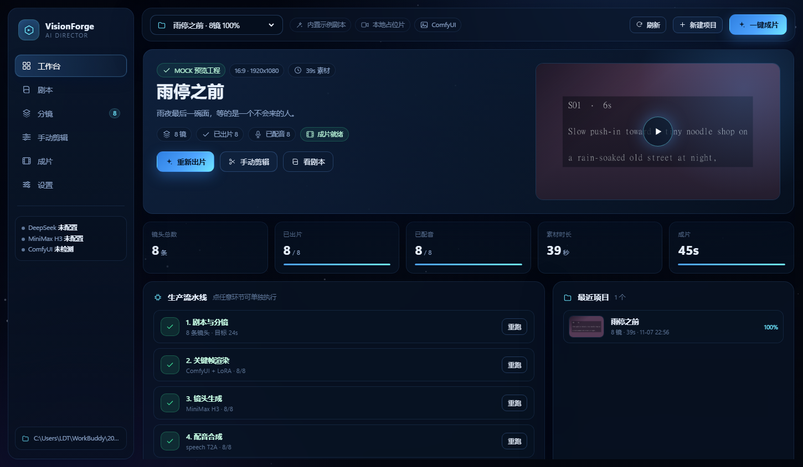
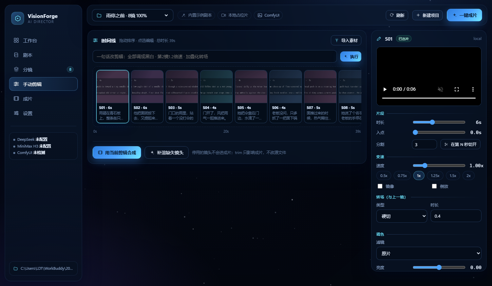
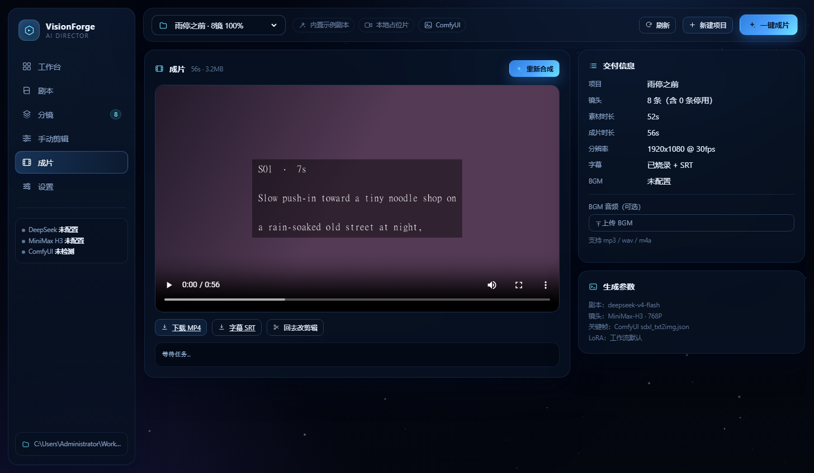
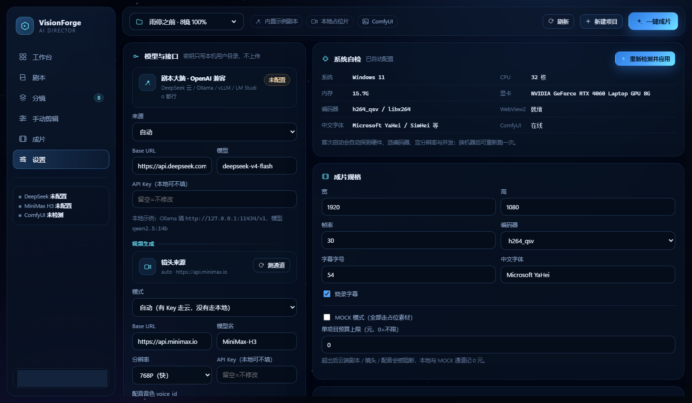
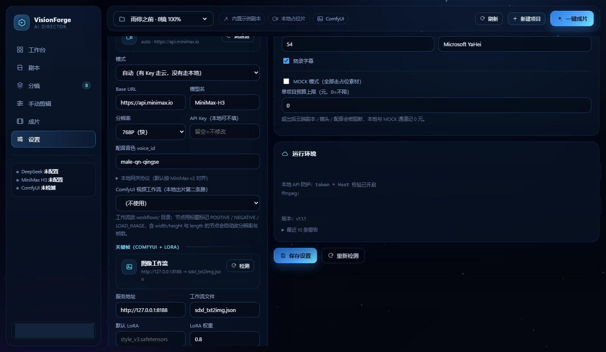

# VisionForge · AI 视频编导台

[](LICENSE)
[](https://www.python.org/)
[](#)
[](#本地模型部署不用-key)

一个跑在本机的桌面级 AI 视频生产工具：**编剧 → 分镜 → 关键帧 → 镜头 → 配音 → 成片**，全流程可在图形界面里盯进度、改分镜、手动剪辑。

模型可全本地：剧本走 Ollama / vLLM，关键帧走 ComfyUI + LoRA，镜头走本地 H3 兼容网关或 ComfyUI 视频工作流——**没有 API Key 也能出片**。

不是"调用一次 API 弹出一段视频"的玩具。它是一条带状态、可断点续跑、可单镜重拍、可人工二次剪辑的生产线。

> 要拿去讲、拿去投、拿去贴给同事看？口语版介绍词在 [docs/介绍词.md](docs/介绍词.md)；学术体的系统描述（摘要 / 方法 / 实验 / 局限 / 参考文献）在 [docs/技术报告.md](docs/技术报告.md)；动手前先看 [使用手册](docs/manual/README.md)，版本变化看 [CHANGELOG](CHANGELOG.md)。

---

## 一、它能干什么

| 能力 | 说明 |
|---|---|
| 自主编剧 | 输入一句需求，DeepSeek 两段式产出「大纲 → 分镜表」，含人物设定、节拍、英文提示词、字幕台词 |
| 关键帧 | ComfyUI API 出图，**LoRA 自动注入**（工作流里没有 LoRA 节点也没关系，会自动插到 checkpoint 与下游之间） |
| 镜头生成 | MiniMax H3 异步任务：文生视频 / 首帧图生视频，自动轮询、下载、重试、敏感词报错识别 |
| 配音 | MiniMax speech T2A 优先，edge-tts 兜底，最后静音兜底（绝不让配音拖垮整片） |
| 剪辑 | ffmpeg 四段式：归一化 → 拼接 → 声轨对位/BGM → 字幕烧录 + 响度归一 |
| 手动剪辑 | 时间线拖拽排序、片段入点 trim、时长、字幕、台词、转场、启用/停用、单镜重拍、本地素材替换/导入 |
| 监控看板 | 任务进度、日志流、分镜状态、成片预览与下载（MP4 / SRT）|
| 断点续跑 | 每一步落盘到 `project.json`，崩了重开继续，不重复烧 token / 不重复扣生成额度 |

---

## 二、界面











---

## 三、快速开始

### A. 直接用打好的 Windows 应用（推荐）

```
dist/VisionForge/VisionForge.exe        # 双击即用
dist/VisionForge-1.1.1-win64.zip        # 便携包，解压后同样是双击 exe
```

首次运行会在 exe 同级生成 `projects/`、`logs/`，并把 API Key 配置文件放到用户目录（Windows：`%APPDATA%\VisionForge\.env`；不会跟着便携包被拷走）。要接真实模型：

1. 打开设置页，填入 `DEEPSEEK_API_KEY`、`MINIMAX_API_KEY`；或参考 `.env.example` 手动编辑用户目录下的 `.env`
2. 重新打开应用

> exe 未做代码签名，Windows SmartScreen 可能拦一下：点「更多信息 → 仍要运行」即可。
> 目标机器需要 WebView2 运行时（Win10/11 一般自带；缺失时应用会改用浏览器打开）。

### B. 从源码运行

```bash
# 1. 依赖（Python 3.10+）
python -m pip install -r requirements.txt

# 2. 配置
copy .env.example .env       # Windows
# cp .env.example .env       # macOS / Linux
# 至少填 DEEPSEEK_API_KEY；想要真镜头再填 MINIMAX_API_KEY

# 3. 启动
python run_app.py            # 也可以双击 启动VisionForge.bat
```

启动器会自动找一个空闲端口起本地服务，然后用 WebView2 开原生窗口；没有 WebView2 时自动退回浏览器。

> ffmpeg 不用单独装：打包版优先用 `_internal` 里版本锁定的静态版；源码运行优先尊重 PATH，找不到再用 `imageio-ffmpeg`。启动时会用一条最小 `drawtext` 命令验活，不能烧字幕的构建会被跳过。

### 命令行参数

```bash
VisionForge.exe                     # 桌面窗口（默认）
VisionForge.exe --port 8765         # 固定端口
VisionForge.exe --serve             # 只起服务，不开窗口（调试/部署用）
VisionForge.exe --browser           # 用系统浏览器打开
```

源码模式同理：`python run_app.py --serve --port 8765`。

### 开发期工具

```bash
python tools/e2e_test.py             # 端到端自测（走 mock，不花钱）
python tools/qa_shot.py --url ...    # CDP 截图做界面回归
```

想把成本压到 0 先把链路跑通：设置页勾上 **MOCK 模式**，或用环境变量 `VF_MOCK=1`。此时剧本用内置示例分镜、镜头用 ffmpeg 生成的占位片、配音走免费 edge-tts，仍会产出完整 MP4（含字幕、混音）。

---

## 本机安全与预算护栏（v1.1.1）

- **本地 API 鉴权**：启动时生成随机 token 写入 `run/token`，所有 `/api/*` 请求必须带 `X-VF-Token`；页面由服务端自动注入
- **Host 校验**：只接受 `127.0.0.1` / `localhost` / `[::1]`，拦截 DNS rebinding；不再开放跨域 CORS
- **媒体保护**：项目视频/图片需要同源 Cookie 或 token 参数，外部网页不能直接窥探 `/media/*`
- **密钥位置**：默认写到 `%APPDATA%\VisionForge\.env`（macOS/Linux：`~/.config/visionforge/.env`），便携包拷走不会带走 Key；旧位置 `.env` 仍兼容读取
- **预算护栏**：`VF_BUDGET=20` 可设置单项目估算成本上限；DeepSeek / MiniMax 调用逐次记账到 `project.json`，超限在调用前阻断，成片页可导出成本小结
- **单实例**：第二个实例不会同时写同一份工程，只会把已有窗口拉到前台
- **孤儿进程清理**：启动时清理上次崩溃遗留的 ffmpeg/ffprobe 子进程
- **Release 校验**：发布页附 `SHA256SUMS.txt`，下载后先核对哈希再运行

自动化测试确需关闭防护时，才临时设置 `VF_ALLOW_UNSAFE_API=1`。

---

## 首次运行自动配置

exe 第一次启动会先做一次体检，再把结果写进 `config.json`（`_meta.auto_configured_at`）：

| 探测项 | 用途 |
|---|---|
| CPU 核数 / 内存 / 磁盘 | 决定并发数；内存 < 8G 自动降到 720p |
| NVIDIA GPU / 显存 | 决定 ComfyUI 出图尺寸（1024×576 ~ 1536×864） |
| ffmpeg 编码器 | **实际跑一帧试编码**，确认 NVENC/QSV/AMF 真能用（编译进来 ≠ 有显卡） |
| 中文字体 | 挑第一个可用的 CJK 字体写进字幕配置 |
| WebView2 | 缺失时自动退回浏览器模式 |
| ComfyUI / 本地视频网关 | 探活，决定默认链路 |

设置页 → 系统自检可以随时重跑，点「重新检测并应用」即可。

> 为什么要“试编码”：ffmpeg 的 `-encoders` 只说明编译时带了 NVENC，虚拟机/无 N 卡的机器照样列出 `h264_nvenc`，真跑就报 `Cannot load nvcuda.dll`。所以这里是跑一帧真实编码来判断。

---

## 本地模型部署（不用 Key）

三个通道都能换成本地，互不冲突：

| 环节 | 云端 | 本地替代 |
|---|---|---|
| 剧本/分镜 | DeepSeek API | 任意 OpenAI 兼容服务：Ollama、vLLM、LM Studio、Xinference |
| 关键帧 | — | ComfyUI + LoRA（`/prompt` 队列） |
| 镜头 | MiniMax H3 | ① 兼容 MiniMax v2 协议的本地网关 ② ComfyUI 视频工作流 |

### 1. 本地大模型（Ollama 示例）

```bash
ollama pull qwen2.5:14b
# .env
DEEPSEEK_MODE=local
DEEPSEEK_BASE_URL=http://127.0.0.1:11434/v1
DEEPSEEK_MODEL=qwen2.5:14b
# DEEPSEEK_API_KEY 留空
```

程序只要求 `/chat/completions` 与 `response_format={"type":"json_object"}`。模型不支持 JSON 模式时会自动重试并要求纯 JSON，再不行降级成本地示例分镜。

### 2. 本地 H3 兼容网关

只要你的服务实现下面两个接口，就能直接接管镜头生成（**不需要 Key**）：

```http
POST {base_url}/v2/video_generation
{ "model": "MiniMax-H3", "content": [{"type":"text","text":"..."},
  {"type":"image_url","image_url":{"url":"data:image/png;base64,..."},"role":"first_frame"}],
  "duration": 6, "resolution": "768P", "ratio": "16:9" }
→ { "task_id": "xxx" }

GET {base_url}/v2/query/video_generation/{task_id}
→ { "task": { "status": "succeeded", "content": { "url": "http://.../out.mp4" } } }
```

```bash
# .env
MINIMAX_MODE=local
MINIMAX_BASE_URL=http://127.0.0.1:8000
MINIMAX_VIDEO_MODEL=MiniMax-H3
```

协议不同也没关系：设置页可以改提交/查询路径，或用「测通道」先确认连通。

### 3. 本地 ComfyUI 视频工作流

把工作流（API 格式）放进 `workflows/`，设置页选中即可。适配器按**节点标题**定位，不依赖节点 id：

| 标题 / 类 | 作用 |
|---|---|
| `POSITIVE` / `NEGATIVE` | 提示词（`text` 与 H3 的 `prompt` 都认） |
| 含 `width` + `height` 的节点 | 分辨率（配了 `MINIMAX_VIDEO_WIDTH/HEIGHT` 才覆盖，否则用工作流自带值） |
| 含 `length` / `num_frames` / `video_frames` 的节点 | 帧数（时长 × fps；H3 自动对齐到 4n+1，上限 15s） |
| `KSampler` / `BasicScheduler` | seed / steps / cfg |
| `RandomNoise` | `noise_seed`（自定义采样链的种子） |
| `LOAD_IMAGE` | 自动上传关键帧作首帧 |
| `SaveVideo` / `VHS_VideoCombine` / `CreateVideo` | 输出与帧率元数据 |

```bash
MINIMAX_MODE=comfyui
MINIMAX_VIDEO_WORKFLOW=wan21_i2v.json
COMFYUI_BASE_URL=http://127.0.0.1:8188
# 视频分辨率/步数不填就沿工作流；填了才覆盖（别拿关键帧的 1344x768 去顶 8GB 显卡）
# MINIMAX_VIDEO_WIDTH=608
# MINIMAX_VIDEO_HEIGHT=352
# MINIMAX_VIDEO_STEPS=4
```

### 4. 本地 H3（ComfyUI + GGUF 量化）

仓库自带 `workflows/minimax_h3_gguf_i2v.json`，对应 ComfyUI 原生的 H3 节点 + GGUF 量化权重，8GB 显存可跑 608×352：

```
models/unet/     minimax_h3_fl2va_pruned-Q2_K.gguf
models/loras/    minimax_h3_fl2v_turbo_4step_v1.0_768p_comfyui_bf16.safetensors
models/clip/     qwen3vl_32b_minimax_h3-Q2_K_M.gguf
models/vae/      minimax_h3_video_vae_fp16.safetensors
```

配好 ComfyUI 服务后，把 `.env.h3.example` 的内容复制到 `%APPDATA%\VisionForge\.env`（macOS/Linux：`~/.config/visionforge/.env`）即可，重启应用后系统自检里镜头通道会显示 `comfyui-video`。这条路的坑与绕法：

- **帧数必须是 4n+1**：H3 的时序 VAE 按 4 帧下采样，120 帧会被截成 117；程序按镜头时长自动对齐（5s×24fps → 121 帧）。
- **步数不要用 SD 的 28**：H3 走 4 步 turbo LoRA，`MINIMAX_VIDEO_STEPS=4` 才是它的正常档位。
- **首帧图生视频**：没有 SDXL checkpoint 时关键帧会用本地占位图，链路仍然通；想真出画就把 `COMFYUI_CHECKPOINT` 指向一个 SDXL 模型。
- **纯文生视频**：`MINIMAX_LOCAL_IMAGE_MODE=skip`，提交前会自动摘掉首帧连线。
- **超时**：本地 8GB 显卡 5 秒镜头约 5 分钟，`MINIMAX_VIDEO_TIMEOUT=5400` 别按云端的 2400 秒算。

### 混合配置

```
剧本：本地 Ollama    （免费、隐私）
关键帧：本机 ComfyUI （免费）
镜头：云端 H3        （质量稳）
配音：edge-tts       （免费）
```

只填一部分也能跑，缺哪环就降级哪环——这是设计前提，不是兜底补丁。

---

## 四、生产链路

```
brief
  │
  ├─ [DeepSeek] 大纲：logline / 人物 / 节拍 / 风格锚点
  ├─ [DeepSeek] 分镜：duration(4~10s) / 运镜 / 台词 / image_prompt / video_prompt
  │
  ├─ [voice]   逐条 TTS → audio/S01.mp3，按音频长度回调镜头时长
  ├─ [ComfyUI] 关键帧 → keyframes/S01.png（LoRA 注入 + seed 固定）
  ├─ [MiniMax] 镜头   → clips/S01.mp4（首帧参考 + 运动提示词，异步轮询）
  │
  └─ [ffmpeg]  归一化 → concat → 声轨 amix → ASS 字幕 → 淡入淡出 → output/*.mp4
```

### 为什么先配音再出镜头

TTS 出来的实际时长常常比剧本估的长。流程把配音放在镜头前，按 `audio_duration + 0.45s` 回调镜头时长（夹在 4~15s，H3 的合法区间），从根上避免"话没说完画面就切了"。

### MiniMax H3 接口要点

```
POST /v2/video_generation            创建任务 → task_id
GET  /v2/query/video_generation/{id} 轮询   → task.status / task.content.url
content[]: {"type":"text"} 必有；首帧 {"type":"image_url","role":"first_frame"}
文生视频必须给 ratio；图生视频 ratio 恒为 adaptive
```

- 本地关键帧以 `data:image/png;base64,...` 内联，超过 20MB 自动退回纯文生视频
- 错误码翻译：`1008` 余额不足、`1026` 提示词敏感、`1002` 限流、`1004` 鉴权 —— 不可重试的直接失败，不浪费轮询时间
- 单任务默认 25 分钟超时，轮询间隔 10s

### ComfyUI + LoRA

工作流按 `class_type` 和 `_meta.title` 定位节点，不依赖节点 id：

- `POSITIVE` / `NEGATIVE` → 提示词
- `EmptyLatentImage` → 尺寸
- `KSampler` → seed / steps / cfg / sampler
- `CheckpointLoaderSimple` → checkpoint

指定 LoRA 时：
1. 工作流里已有 `LoraLoader` → 直接改 `lora_name` / `strength`
2. 没有 → 新建 `LoraLoader` 节点，把所有引用 checkpoint 输出的 `[id, 0]`/`[id, 1]` 改指向 LoRA 节点

自带 `workflows/sdxl_txt2img.json` 与 `workflows/flux_txt2img.json` 两套模板。

### 剪辑台的四段

1. **归一化**：缩放+黑边填充、统一 fps/SAR、`tpad` 补帧到精确时长、静音剥轨
2. **拼接**：concat demuxer，参数一致时 `-c copy`
3. **声轨**：逐条 `adelay` 对位 + 静音底 + BGM 循环衰减 + `amix normalize=0`
4. **定版**：`ass` 烧字幕 + 淡入淡出 + `loudnorm` + `+faststart`

缓存文件名带 `时长-trim-转场` 指纹，改了剪辑参数才重算，没改就复用。

---

## 五、手动剪辑（对标剪映常用能力）

时间线页 = 轨道 + 检查器。选中任意镜头，右侧可调：

| 分组 | 能力 |
|---|---|
| 片段 | 拖拽排序、入点 trim、时长 1~15s、**在第 N 秒切成两条**、复制、删除、停用、换素材/导入素材 |
| 变速 | 0.25x~4x（滑杆 + 0.5/0.75/1/1.25/1.5/2 快捷档），倒放，水平镜像 |
| 转场 | 11 种：硬切 / 淡入淡出 / 叠化 / 左划 / 右划 / 上滑 / 下滑 / 放大推入 / 黑场 / 白闪 / 圆形展开；每条可单独设 0.1~1s 时长 |
| 调色 | 7 个滤镜预设（电影青橙 / 黑白 / 复古胶片 / 冷调 / 暖调 / 高饱和 / 原片）+ 亮度 / 对比度 / 饱和度 / 色温 |
| 文字层 | 每条镜头可叠一句文字，位置（顶/中/底）、字号可调，与字幕分层渲染互不打架 |
| 声音 | 逐条音量 0~200%、BGM 音量与淡入淡出、全片 `loudnorm` 归一 |
| 字幕 | 逐条改字幕/台词，自动折行、避开转场重叠、导出 SRT |
| AI 指令 | 输入「全部调成黑白，第2镜1.5倍速，加叠化转场」，DeepSeek 解析成批量操作；没配 key 时本地规则兜底 |

技术实现要点：

- **真转场**走 ffmpeg `xfade` 链，时间轴按重叠秒数收缩，字幕/配音起点同步重算
- 硬切在 xfade 链里用 0.04s 融合占位（视觉上就是切），避免 `duration=0` 把后续片段吞掉
- 归一化缓存按「时长 / 入点 / 变速 / 镜像 / 调色 / 分辨率」指纹命名，改哪项重算哪项

改完点「用当前剪辑合成」即可，SRT 会同步重新生成。

### 没做的部分（说清楚，不装）

剪映是多轨 NLE，我们是「AI 生成 + 单轨精修」，以下能力**没有**实现，也不打算用假按钮糊弄：

- 多视频轨 / 画中画 / 多机位
- 关键帧动画（位置、缩放、透明度曲线）
- 蒙版、混合模式、绿幕抠像、智能抠像
- 曲线变速、光流补帧
- 卡点（BGM 节拍检测）、贴纸、花字模板库
- 智能字幕（语音识别打轴）、数字人

要这些得上真正的 NLE 数据模型（图层树 + 关键帧曲线 + 合成器），不是加几个 ffmpeg 参数能解决的。真需要可以导出 XML/EDL 交给剪映精修——这个接口比硬造一个半成品多轨编辑器靠谱。

---

## 六、目录结构

```
videoforge/
  config.py            配置四层合并（.env → 环境变量 → config.json → CLI/接口）
  llm.py               DeepSeek 客户端：JSON 模式、工具调用、模型回退、JSON 抢救
  schemas.py           Project / Shot / Script 数据模型
  utils.py             ffmpeg 定位、原子写、重试、日志
  providers/
    minimax.py         H3 视频生成
    comfyui.py         工作流补丁 + LoRA 注入 + 队列轮询
    local.py           离线占位片
    tts.py             MiniMax T2A / edge-tts / 静音
  pipeline/
    writer.py          剧本 → 分镜
    director.py        并发渲染、断点续跑、时长回调、单镜重拍
    editor.py          ffmpeg 四段合成
    subtitles.py       ASS / SRT
  web/
    server.py          FastAPI 接口
    jobs.py            单窗口任务队列 + 日志回传
    static/            index.html + app.js（星空背景 / 时间线 / 看板）
  desktop.py           pywebview 桌面壳
workflows/             ComfyUI API 格式工作流
tools/
  e2e_test.py          端到端验收（mock）
  qa_shot.py           CDP 截图工具（开发用）
projects/<slug>/       每个项目：project.json / keyframes / clips / audio / cache / output
```

---

## 七、接口一览

| 方法 | 路径 | 说明 |
|---|---|---|
| GET | `/api/bootstrap` | 启动信息：项目列表、provider 状态、渲染规格 |
| POST | `/api/projects` | 新建（异步任务，返回 job id） |
| GET | `/api/projects/{slug}` | 项目全量（含每个镜头的媒体 URL） |
| PATCH | `/api/projects/{slug}` | 改片名 / BGM / 剧本字段 |
| POST | `/api/projects/{slug}/actions` | `voice` / `keyframes` / `clips` / `render` / `assemble` / `all` |
| PATCH | `/api/projects/{slug}/shots/{sid}` | 手动剪辑字段 |
| POST | `/api/projects/{slug}/reorder` | 时间线排序 |
| POST | `/api/projects/{slug}/shots/{sid}/revise` | 按意见重拍 |
| POST | `/api/projects/{slug}/shots/{sid}/replace` | 上传替换素材（raw body） |
| POST | `/api/projects/{slug}/shots/import` | 追加本地素材 |
| GET | `/api/jobs/{id}?since=N` | 任务状态 + 增量日志 |
| GET | `/api/system/doctor` | ffmpeg / ComfyUI / LoRA / checkpoint 体检 |

---

## 八、测试

```bash
# 起服务后
python tools/e2e_test.py
```

覆盖：建项目 → 全量渲染 → 改字幕/时长/trim → 停用镜头 → 重排 → 合成 → 校验成片存在、停用镜头被排除、SRT 含人工修改 → 单镜重拍 → 二次合成。

验证本地 H3 网关（不需要真模型）：

```bash
# 一个 60 行的 mock 服务，实现 /v2/video_generation 与查询接口
python tools/mock_h3_server.py --port 8798 --video projects/demo/clips/S01.mp4

MINIMAX_MODE=local MINIMAX_BASE_URL=http://127.0.0.1:8798 python run_app.py
```

开发期界面回归：

```bash
python tools/qa_shot.py --url http://127.0.0.1:8765 --out .tmp/shots/dash.png --wait 6
```

---

## 九、常见问题

**ComfyUI 连不上**
出关键帧会自动降级成本地占位图，流程不中断。去设置页点「检测」，能列出 LoRA 就说明通了。

**H3 一直 queued**
并发数调小（`VF_WORKERS=2`），或看账户余额（错误码 1008）。

**字幕是方块**
换 `VF_SUBTITLE_FONT` 为本机有的中文字体（Windows：Microsoft YaHei / 思源黑体）。

**成片比素材短**
正常：片头 3.2s + 片尾 3.4s 不计入素材时长，停用镜头也不算。

**想改画幅**
新项目时选 9:16 / 1:1；已有项目改 `VF_WIDTH/HEIGHT` 后需重新合成（归一化会重跑）。

---

## 十、成本与边界

- 剧本/分镜：约 6k~12k tokens / 分钟级片子
- 镜头：按 H3 计费秒数（`billable_seconds` 可查），10 条 6s 镜头 ≈ 60s 成片
- 关键帧：本地 GPU 电费
- 配音：MiniMax 按字符，edge-tts 免费
- ffmpeg 合成纯本地

边界：H3 单镜 4~15s，一镜内别指望它换场景或演复杂多人互动；分镜提示词已经把这条纪律写死在系统提示里。

---

## 十一、重新打包

```bash
python -m pip install pyinstaller
python build_app.py --clean
```

产物：

```
dist/VisionForge/VisionForge.exe       # onedir，启动快（约 144MB）
dist/VisionForge-1.1.1-win64.zip       # 便携包（约 57MB）
```

打包细节（`VisionForge.spec`）：

- 资源随包：`web/static`、`workflows`、`examples`、`assets`、`.env.example`
- `collect_all` 收 `webview`（含 WebView2 DLL）、`imageio_ffmpeg`（ffmpeg 静态版）、`edge_tts`、`fastapi/uvicorn`
- 手动补 `clr.pyd` + `Python.Runtime.dll`（pythonnet 不按包分发，容易漏）
- `uvicorn` 固定 `loop=asyncio / http=h11 / ws=none`，绕开 uvloop、httptools、websockets 三个隐形依赖
- 路径策略：`APP_ROOT`（exe 同级，可写）放 `.env / projects / logs`，`BUNDLE_ROOT`（`_internal`）放只读资源

打包后自检：

```bash
cd dist/VisionForge
VisionForge.exe --serve --port 8791
curl http://127.0.0.1:8791/api/bootstrap
```

日志在 `logs/runtime.log`，启动崩溃会写 `logs/startup-error.log` 并弹原生提示框。

---

## 开源协议

[MIT](LICENSE)。商用、二改、闭源分发都可以，保留版权声明即可。

贡献前读一下 [CONTRIBUTING.md](CONTRIBUTING.md)；安全问题走 [SECURITY.md](SECURITY.md) 的私密渠道。
